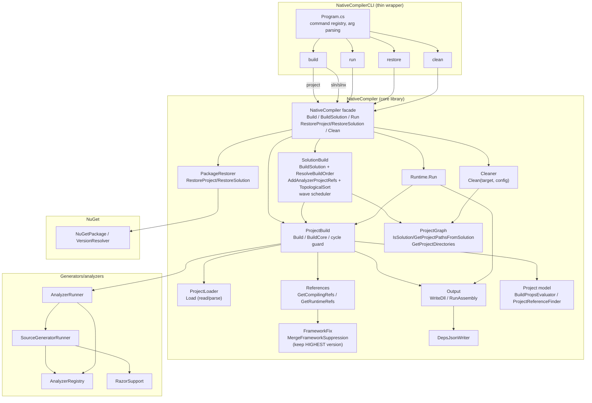

# Sharp Compiler Architecture — v1.1 (unified)

One diagram showing the hierarchy: CLI is a thin wrapper over the `NativeCompiler` core library. The core library exposes the same command surface (`Build`, `BuildSolution`, `Run`, `RestoreProject`/`RestoreSolution`, `Clean`) so it can be consumed as a library without depending on the CLI. Implementation lives in intent-based vertical slices.

Notes:
- `Clean` moved into the core (`Cleaner.Clean`) so both CLI and library consumers can clean project outputs. CLI only formats/parses; the logic lives under `NativeCompiler.Cleaner`.
- Restore is part of the core (`PackageRestorer`) and exposed via the `NativeCompiler` facade; CLI delegates. Diagram shows restore under the core, not a separate detached box.
- Solution builds use wave scheduling (Kahn) with analyzer project references (self-edges skipped); single-project builds have a cycle guard and return a failed `BuildResult` on resolution errors.
- Reference dedup keeps the **highest** assembly version on simple-name clashes (`FrameworkFix`).
