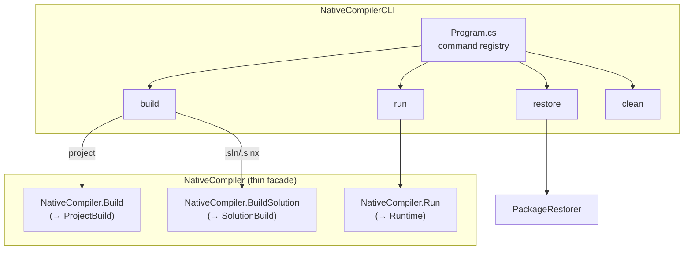
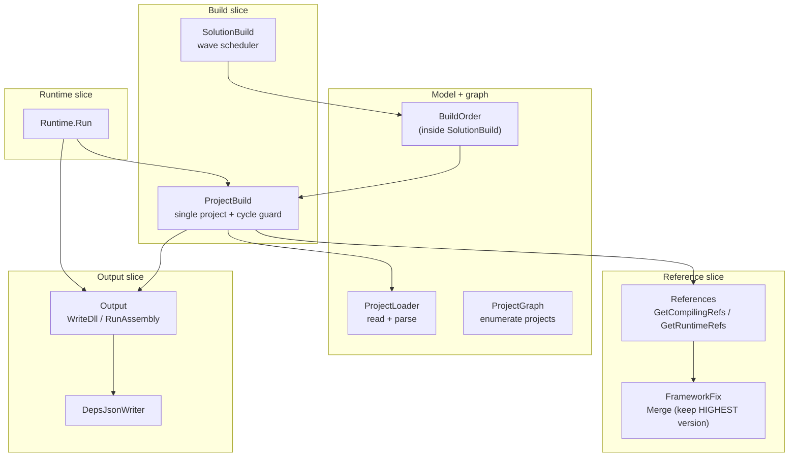
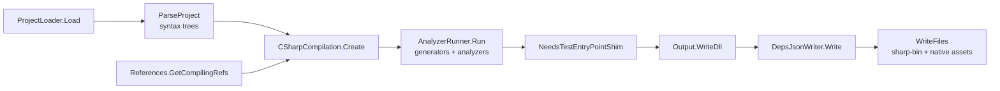
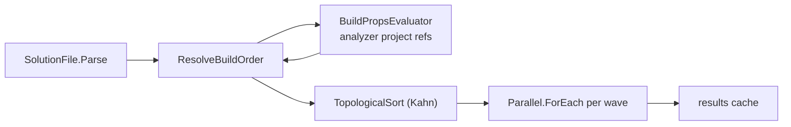
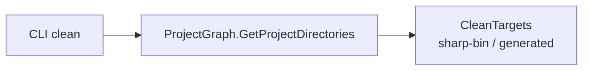

# Sharp Compiler Architecture — v1.1

Intent-based vertical-slice layout of the `NativeCompiler` engine, the `NativeCompilerCLI`
command layer, and the reference/NuGet support code.

**v1.1** reflects the refactor that turned the single `NativeCompiler.cs` god class into
one class per responsibility, with the code physically moved (not wrapped).

---

## 1. Top level — command layer and engine entry points

`NativeCompiler.cs` is now only 42 lines: the three public entry points plus the
`BuildResult` / `SolutionProjectResult` / `BuildSolutionResult` records. All implementation
lives in the slice modules below.

---

## 2. Engine slices — one class per responsibility

- `Build/ProjectBuild.cs` — full `Build`/`BuildCore` body, `BuildsInProgress`, `WriteFiles`.
- `Build/SolutionBuild.cs` — full `BuildSolution` body, `ResolveBuildOrder`,
  `AddAnalyzerProjectReferences`, `TopologicalSort` (private).
- `Emit/Output.cs` — real Roslyn `WriteDll` (`ProduceDll`) and `RunAssembly` bodies.
- `References/FrameworkFix.cs` — real `MergeFrameworkSuppression` (moved out of
  `NativeCompilerUtils.cs`).
- `References/References.cs` — `GetCompilingRefs` / `GetRuntimeRefs`.
- `Loading/ProjectLoader.cs` — file-read + model parse.
- `Graph/ProjectGraph.cs` — solution/project enumeration (used by CLI `clean`).
- `Runtime/Runtime.cs` — build + run orchestration.

---

## 3. Single-project build pipeline (`ProjectBuild.Core`)

`Build` wraps `Core` in a try/catch so a resolution failure is reported as a failed
`BuildResult` instead of an unhandled exception (SIGABRT). The `BuildsInProgress` dictionary is
the cycle guard for re-entrant builds.

---

## 4. Solution build — dependency waves

`ResolveBuildOrder` walks raw `<ProjectReference>` items plus `BuildPropsEvaluator` analyzer
references (self-edges skipped — the evaluator ignores `Condition`). Kahn's algorithm groups
ready projects into waves; every member of a wave can build concurrently because no wave member
references another. Cycles are still emitted so every project gets reported.

---

## 5. Clean — independent of the build pipeline

`clean` resolves project roots through `ProjectGraph` (solution enumeration only). It never
invokes `Build`, so cleaning works even for projects that no longer compile.

---

### Build semantics recap

- `ProjectBuild.Build(path)` recursively resolves and builds referenced projects on demand.
- `SolutionBuild.Build(solution)` parses the `.sln/.slnx`, plans a dependency-ordered wave
  schedule, and builds each wave's projects concurrently via a thread-safe per-solution cache.
- Reference dedup keeps the **highest** assembly version on a simple-name clash (`FrameworkFix`).
