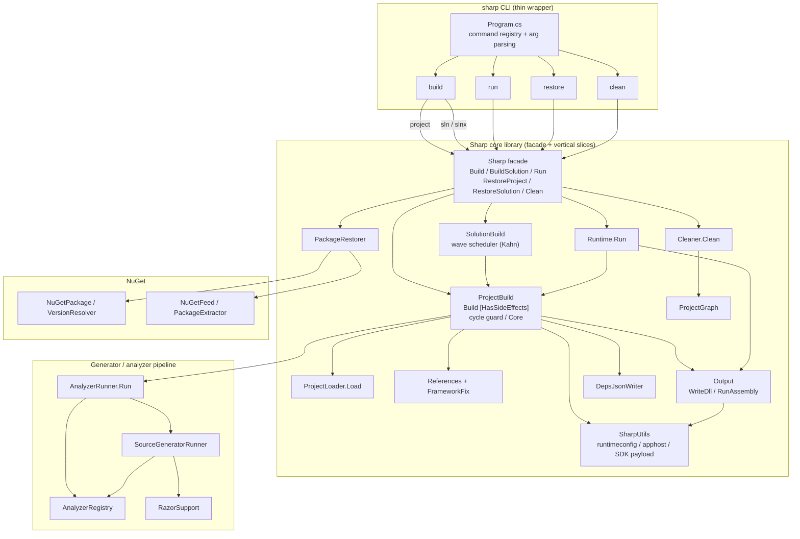
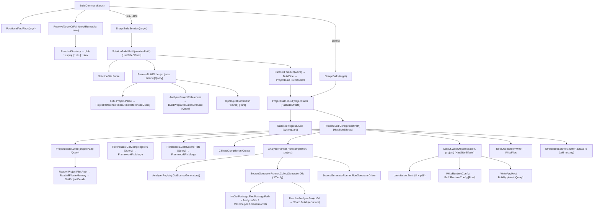
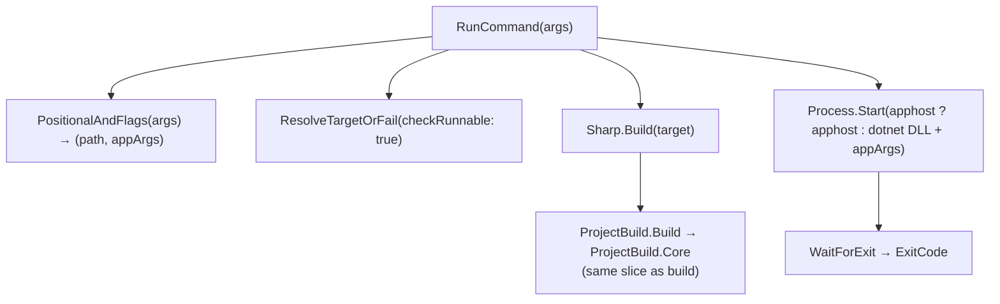
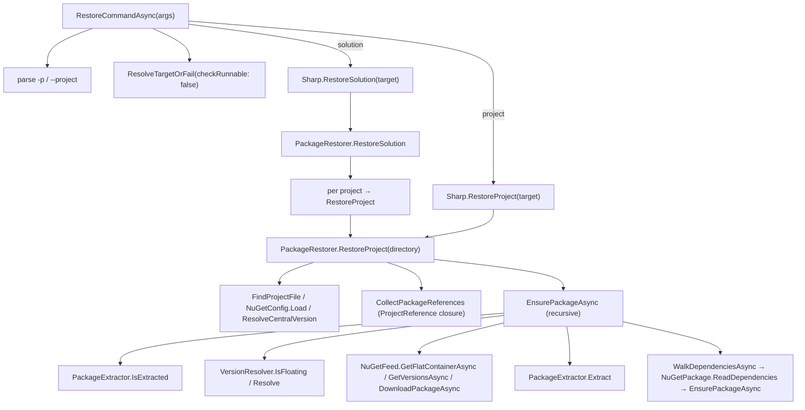
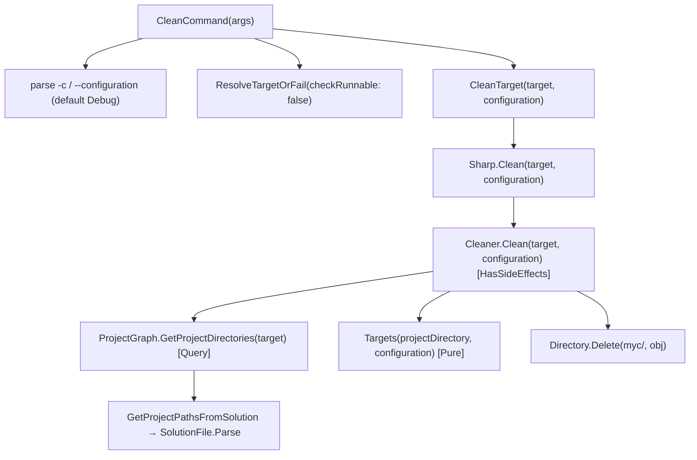
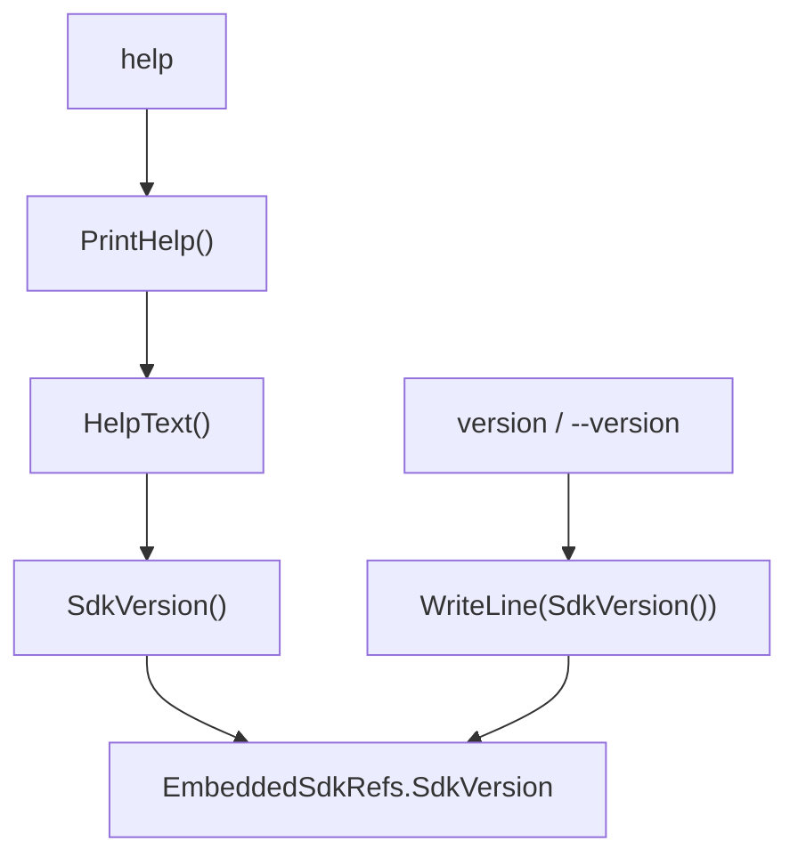

# Sharp Compiler — Architecture & CLI Call Chains

**Version 1.2** · Native `dotnet build` in one binary

---

## Design intent

Sharp is a from-scratch reimplementation of the parts of the .NET SDK that turn a
project into a runnable artifact. `dotnet build` is a large machine: MSBuild
evaluates properties, the SDK resolves the framework and NuGet graphs, and `csc`
(plus a crowd of source generators and analyzers) produces the assembly. Sharp
collapses that machine into a single self-contained compiler that can run on a
machine with **no .NET SDK installed at all**.

Three principles shape the whole codebase.

**One facade, many slices.** The public surface is a tiny static facade —
`SharpCompiler.Build`, `BuildSolution`, `Run`, `RestoreProject`,
`RestoreSolution`, `Clean`. Everything behind it is organised as *intent-based
vertical slices*: `ProjectBuild` builds one project, `SolutionBuild` schedules a
solution, `PackageRestorer` restores packages, `Cleaner` removes output. Each
slice owns one verb and its own data, and no slice reaches into another's
internals.

**The CLI is a thin wrapper.** `Program.cs` parses arguments and formats output
in the exact grammar of the .NET SDK's terminal logger. Every command then
delegates straight into the facade. Nothing about *how* to build lives in the
front-end, so the same core is usable as a library — the tests call it directly.

**Purity is a property, not a hope.** Core methods carry an explicit contract
attribute: `[Pure]` means deterministic with no I/O and no shared-state mutation;
`[Query]` means it reads external state but does not mutate; `[HasSideEffects]`
marks the few methods that write files, populate caches, or touch process state.
Reading a slice's signatures tells you exactly where the effects live.

## The shape of the system

The CLI and the core library are separated by a single seam. Above it, argument
parsing and SDK-parity text. Below it, the compiler proper.

The core library is itself layered. `ProjectBuild` is the spine of a single
compilation; `SolutionBuild` sits above it as a scheduler; `Runtime` composes a
build with execution. Supporting slices — loading, reference resolution, emission,
the generator pipeline, NuGet — hang off that spine.

## The build pipeline

Building one project (`ProjectBuild.Core`) is a sequence of clearly bounded
stages. Understanding this sequence is understanding the compiler.

**Load.** `ProjectLoader.Load` reads the project's source files and its XML,
and produces the `Project` model: target framework, package and project
references, compilation options, analyzer references. This is pure reading —
`[Query]` — and it is the cheapest part of the pipeline.

**Resolve references.** Two reference sets are assembled. The *compiling* set
(passed to Roslyn) is the project's NuGet and project dependencies merged with
the SDK ref-pack and framework reference assemblies. The *runtime* set is only
the project's own dependencies, because shared-framework assemblies come from
the installed runtime at execution time and are never copied next to the app.
Both pass through `FrameworkFix.Merge`, which mirrors NuGet's framework-assembly
suppression and, on a simple-name clash, keeps the **highest** assembly version —
the lower one would produce `CS1705`.

**Generate and analyse.** `AnalyzerRunner.Run` first runs source generators, then
runs analyzers over the merged compilation. The generator set is always the
statically linked SDK set, so behaviour is identical under JIT and NativeAOT.
Under JIT the runner additionally discovers the project's own generators — package
analyzers and `Analyzer` project references — through a shadow-copied load
context. Errors gate the build exactly as compile errors do; warnings are returned
to the CLI, which renders them per-project.

**Emit.** `Output.WriteDll` hands the compilation to Roslyn's emitter (a
portable PDB, matching the SDK's PE characteristics), then writes the runtime
configuration and, for console applications, the apphost. The try/catch around
it guarantees that a failed or crashed emit never leaves a half-written DLL
behind.

**Place artifacts.** The remaining stages mirror what `dotnet build` leaves in
`bin`: the runtime dependency set, hint-path copy-local assemblies, a
`*.deps.json` graph written by `DepsJsonWriter`, runtime-native assets, and — when
the project consumes Sharp itself — the embedded SDK payload, so the compiler can
reproduce itself without MSBuild.

A single-project build guards against reference cycles with an in-progress set
and converts any resolution failure into a normal failed `BuildResult` instead of
letting it escape as an unhandled exception.

## Building a solution

`SolutionBuild` wraps the single-project build in a scheduler. It first walks
the project-reference graph — including generator projects injected through
`Directory.Build.props` — and produces a **wave plan** using Kahn's algorithm.
Every project in a wave has all of its dependencies in earlier waves, so the
whole wave can be built concurrently. Waves where a project cannot be ordered
(a genuine cycle) are still attempted serially, so the build reports *every*
project rather than aborting on the first problem.

## Generators and analyzers

Source generators are where the SDK hides a surprising amount of work:
regular-expression and JSON serialisers, library-import interop, Razor views,
and framework-specific generators such as ASP.NET Core's public-`Program` shim.
Sharp runs them through the real Roslyn generator driver rather than
hand-synthesising any code.

The pipeline is deliberately AOT-safe. Under NativeAOT, dynamic assembly loading
is impossible, so only the statically linked registry of generators runs. Under
JIT, the project's own generator DLLs are shadow-copied into a private load
context — copying rather than loading in place, so a later rebuild can overwrite
the original file — and any generator already linked statically is skipped to
avoid running it twice.

## Restore and clean

Both are first-class commands in the core, not CLI-only helpers, so the compiler
is useful as a library.

`PackageRestorer` walks the transitive package graph from `nuget.config` feeds,
resolves versions (including floating-version rejection), downloads and extracts
packages into the global packages folder, then recurses into each package's
nuspec dependencies. Solution restore simply restores every project and reports
them individually.

`Cleaner` is intentionally independent of the build pipeline: it enumerates the
project directories via `ProjectGraph` and deletes only Sharp's own output trees.
The SDK's `bin/` is left untouched, because that is the baseline the parity tests
compare against.

## The CLI contract

`Program.cs` is a faithful reproduction of `dotnet`'s command-line behaviour:
the same command registry, the same positional-argument and `--project`
handling, the same MSBuild error codes (`MSB1003`, `MSB1011`, `MSB1050`), and
the same terminal-logger summary lines with measured seconds and output paths
relative to the current directory. A legacy bare-path invocation is treated as
`build`.

One subtlety is worth calling out: the CLI's `run` command builds the project
and then launches the result as a **child process** (the apphost when present,
otherwise `dotnet <dll>`), inheriting its streams and exit code. The in-process
`Runtime.Run` path — which loads the freshly compiled assembly and invokes its
entry point via reflection — is used only by library consumers and tests, not by
the CLI.

---

<!-- pagebreak -->

## CLI call chains

Each diagram below traces the actual method calls, from the command handler down
to the leaf operations. Purity labels are shown where the core defines them.

### `build <project | .sln | .slnx>`

A single project goes through `ProjectBuild`; a solution goes through the
`solution` scheduler, which then fans back into `ProjectBuild` for each project.
The one back-edge worth noting is generator build-on-demand: when a standalone
build needs an `Analyzer` project's output and it is not present, the compiler
builds it recursively through the same facade.

### `run <project> [args]`

### `restore [path] [-p | --project]`

### `clean [-c | --configuration <name>] [path]`

### `help` / `version`

---

## Summary

Sharp is a compiler, a NuGet restorer, a solution scheduler, and a clean tool
behind a six-method facade. The front-end is a thin SDK-compatible shell; the
backend is a set of intent-named slices whose effect boundaries are declared in
their signatures. That combination — a small dynamic library surface over an
AOT-safe generator pipeline — is what lets one self-contained binary stand in
for `dotnet build` on a machine that has no SDK at all.
